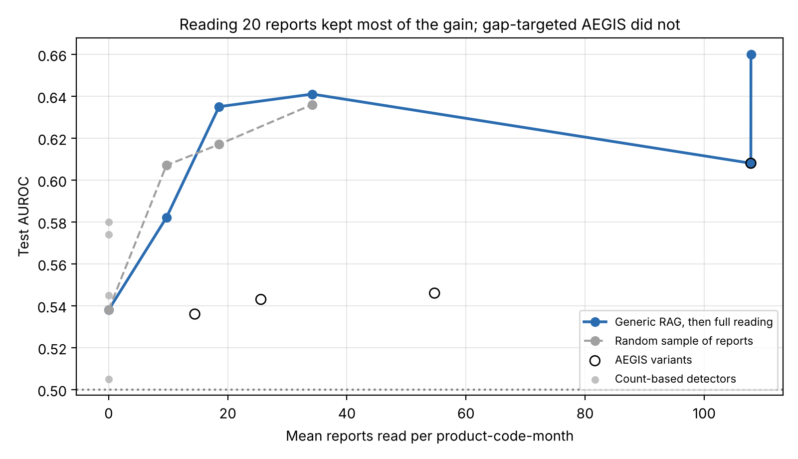

# AEGIS-MD: a MAUDE-to-recall benchmark for medical device safety signal detection

This repository builds a benchmark from public openFDA data that links FDA **MAUDE** adverse-event reports to later **Class I medical device recalls**. Every step is designed so that no information from after the prediction month reaches the model. On this benchmark it evaluates:

- count-based surveillance detectors;
- fusion of evidence extracted from report text;
- **AEGIS** (Adaptive Evidence-Gap Investigation of Safety signals), a retrieval loop that fetches reports for whichever evidence gap has the highest value of information.

All data are real public FDA data. Nothing is synthetic.

## Main findings (test period Jul 2022 – Jun 2025: 2,407 product-code-months, 9.9% positive, 67 recall events)

| Method | Reports read per case | AUPRC [95% CI] | AUROC |
|---|---|---|---|
| Count-based detectors (Poisson, CUSUM, Mann–Kendall, Isolation Forest) | 0 | 0.118 – 0.137 | 0.505 – 0.580 |
| GBM, routine count features | 0 | 0.146 [0.093, 0.217] | 0.602 |
| Fusion + generic RAG (k = 20) | 18.5 | 0.170 [0.091, 0.278] | 0.635 |
| Fusion + all recent reports | 107.9 | 0.177 [0.103, 0.276] | 0.660 |
| **GBM, routine + all recent reports** | 107.9 | **0.183** [0.109, 0.285] | **0.663** |
| AEGIS gap retrieval (VoI policies) | 14.5 – 54.7 | 0.117 – 0.129 | 0.536 – 0.546 |
| AEGIS, VoI-gated full reading | 107.8 | 0.140 [0.094, 0.216] | 0.608 |

1. **Report counts alone barely anticipate Class I recalls**: AUROC of 0.58 at most.
2. **Report text adds modest signal**: AUROC rises to 0.66, but the confidence intervals overlap with the count-only methods.
3. **A generic sample of 20–40 reports recovers most of that gain** at about one fifth of the reading cost.
4. **AEGIS gap-targeted retrieval did not improve detection.** It does worse than generic or random reading at similar cost. The probable cause is that reading only 10 query-selected reports per gap gives biased, noisy evidence. Details and ablations are in [`results/RESULTS.md`](results/RESULTS.md).



## Data

| Source (openFDA) | Use |
|---|---|
| `/device/recall` + `/device/enforcement` (2012–2026, 40,636 recalls) | Labels (recall class), and earlier recalls used as precedents |
| `/device/event` count endpoint | Exact monthly report counts per product code |
| Device-event quarterly bulk files (2014–2025, 240 files) | 334,438 reports: a uniform random sample of up to 60 per product code per month |

- **Panel:** 76 product codes. 50 had a Class I recall during 2016–2025. The other 26 were recalled, but only ever at Class II or III.
- **Case:** one product code in one month *t*. A case is positive if a new Class I recall is initiated in *t*+1 to *t*+6.
- **Leakage controls:**
  - Reports are placed by the date FDA received them.
  - Earlier recalls count only from their public posting date.
  - Any sentence mentioning a recall is deleted from report text.
  - The 6 months after each recall are dropped.
  - Train, validation and test splits are strictly by time (train ≤ 2020-12, validation ≤ 2022-06, test up to 2025-06).

## Repository layout

```
notebooks/
  modular/        AEGIS_01..05: one notebook per stage (data, GPU enrichment, features, evaluation, LLM explanations)
  kaggle_runs/    the exact notebooks used for the reported run:
                  AEGIS_data_CPU -> AEGIS_full_pipeline (GPU) -> AEGIS_experiments
src/              notebook sources (# %% cells) + aegis_core.py, the shared library
tests/            mock openFDA responder + bulk-download harness for offline testing
tools/            build_notebooks.py: rebuilds the .ipynb files from src/
results/          RESULTS.md, results_test.csv, benchmark_summary.csv, figures/
```

## How to reproduce on Kaggle

| Step | Notebook | Accelerator | Internet | Input to attach | Approx. time |
|---|---|---|---|---|---|
| 1 | `kaggle_runs/AEGIS_data_CPU` | None | ON | – | ~50 min |
| 2 | `kaggle_runs/AEGIS_full_pipeline` | GPU T4 | ON | output of step 1 | ~75 min (embeddings 15 min, NLI ~45 min) |
| 3 | `kaggle_runs/AEGIS_experiments_GPU` | GPU T4 (CPU also works) | ON | output of step 2 | ~6 min on CPU, plus the LLM step on GPU |

- **API key:** none is needed. Without one, openFDA refuses only the cross-code aggregate count, and the code falls back to a candidate pool drawn from the recall database. An `OPENFDA_API_KEY` Kaggle secret is used if present.
- **Outputs:** each notebook writes to `/kaggle/working`. Attach a notebook's output to the next one with **Add Input → Notebook Output**.
- **Settings:** all of them live in `CFG` in `src/aegis_core.py`, including the label classes, horizon, washout, split dates and seed.

### Offline test (no network)

```bash
cd src && cp aegis_core.py ../tests/ && cd ../tests
sed 's/^# %%writefile-core//' ../src/nb1_data.py > nb1.py
AEGIS_MOCK=1 AEGIS_OUT=$PWD AEGIS_DIR=$PWD PYTHONHASHSEED=0 python bulk_harness.py
```

## Models

- `BAAI/bge-small-en-v1.5`: report embeddings
- `cross-encoder/nli-deberta-v3-base`: whether each manufacturer investigation confirms or contradicts the reported problem
- `Qwen/Qwen2.5-3B-Instruct`: optional explanations that cite the evidence they rest on (not evaluated in the reported run)

## Data files

`data/datasheet/` lists the product codes, Class I recall events and splits for both panels, and `data/labelling/` holds the blind manual-validation sheets (prepared but not labelled for the study). See `data/DATASHEET.md`.

## Revision analyses (v2, November 2026)

| Notebook (`notebooks/kaggle_runs/`) | Script (`src/`) | What it does |
| --- | --- | --- |
| `AEGIS_revision_analyses.ipynb` | `nb6_revision.py` | Main panel: disproportionality (PRR, ROR, EBGM), recall-history and text baselines, paired product-code bootstrap for H1–H3, 3/12-month horizons, initial-reports and washout sensitivity analyses, validation ablations, per-event results, manual-labelling sheets |
| `AEGIS_random_panel_data.ipynb` | `nb7_random_panel_data.py` | Draws 900 random product codes (seed 2026), keeps the 110 with ≥24 reports in 2014–2015, and builds their report sample |
| `AEGIS_random_panel_eval.ipynb` | `nb8_setup.py` + `nb2_enrich` + `nb6_revision.py` | Runs the full revision analysis on the random panel (realistic prevalence) |
| `AEGIS_revision_extras.ipynb` | `nb9_extras.py` | Calibration by decile, comparisons against Poisson CUSUM, alert workload and per-event ranks for both panels |
| `AEGIS_export_sheets.ipynb` | `nb10_export.py` | Exports the datasheets and labelling sheets in `data/` |

Results are in `results/revision/`.

`notebooks/modular/AEGIS_05_LLM_explanations_GPU.ipynb` is earlier exploratory work (LLM-written explanations) and is not part of the analyses reported in the JAMIA manuscript. `tools/score_labels.py` scores the blind manual-labelling sheets.

## Limitations

- The main panel is small (76 codes) and selected on the outcome; the random panel (110 codes) has only 22 test-period events.
- Comparison codes were drawn from recalled devices, never from devices with no recall history.
- Labels are per product code, not per manufacturer.
- At most 60 reports are sampled per code-month.
- Leakage controls depend on MAUDE's update behaviour, so some residual leakage cannot be ruled out.

## Citation

Mohan Babu A, Madhan E S. *Do adverse event narratives anticipate Class I medical device recalls? A leakage-controlled MAUDE benchmark.* Manuscript submitted to JAMIA. Please cite the archived release (Zenodo DOI on the repository page).

## License

MIT (see `LICENSE`).
